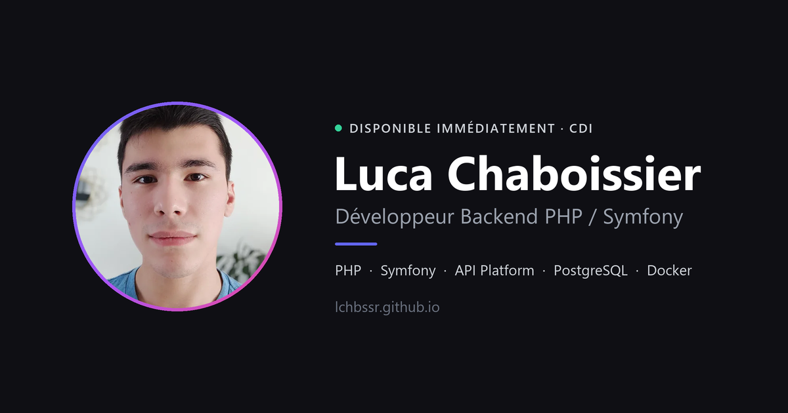

# Luca Chaboissier — Portfolio

> Développeur Backend PHP / Symfony · Nantes / Vendée · Disponible immédiatement

**🌐 [lchbssr.github.io](https://lchbssr.github.io/)**

[](https://lchbssr.github.io/)

Portfolio personnel présentant mon parcours (2 ans d'alternance chez APRIL Marine sur des APIs métier, Mastère Expert en Développement Full Stack), mes compétences et mes projets.

## Stack

| Domaine | Outils |
|---|---|
| Framework | [React 19](https://react.dev/) + [TypeScript](https://www.typescriptlang.org/) |
| Build | [Vite 7](https://vite.dev/) (SWC) |
| Style | [Tailwind CSS 4](https://tailwindcss.com/) |
| Animations | [Motion](https://motion.dev/) |
| Icônes | [Lucide](https://lucide.dev/), [Simple Icons](https://simpleicons.org/) |
| Formulaire | [Web3Forms](https://web3forms.com/) |
| Déploiement | GitHub Actions → GitHub Pages |

## Fonctionnalités

- Thème clair / sombre, qui suit la préférence système et mémorise le choix de l'utilisateur, sans flash au chargement
- Frises chronologiques des expériences et formations
- Galerie d'images des projets, navigable au clavier (← → Échap)
- Formulaire de contact fonctionnel, sans backend
- Optimisé pour le partage et le référencement : balises Open Graph, données structurées `Person`, images WebP chargées à la demande
- Accessible : animations réduites si le système le demande, galerie en `dialog` avec gestion du focus, libellés ARIA en français
- Aucune ressource externe chargée : logos et images sont servis par le site lui-même

Pour modifier le contenu (expériences, formations, compétences), il suffit d'éditer les fichiers de `src/data/`.

## Structure

```
src/
├── components/
│   ├── layout/      # Navigation, Footer
│   ├── sections/    # Hero, About, Experience, Formation, Skills, Projects, Contact
│   └── ui/          # Composants réutilisables (SectionHeading, Timeline, ImageGallery)
├── contexts/        # ThemeContext (clair / sombre)
├── data/            # Contenu : expériences, formations, compétences
├── lib/             # Utilitaires
├── App.tsx
└── main.tsx
public/
├── assets/          # Photo de profil
├── cv/              # CV au format PDF
├── projects/        # Captures des projets (WebP)
└── skills/          # Logos des technologies (SVG, hébergés localement)
```

## Lancer le projet

Prérequis : Node.js 20 ou plus.

```bash
npm install
npm run dev        # serveur de développement sur http://localhost:5173
npm run build      # vérification TypeScript + build de production dans dist/
npm run preview    # prévisualise le build de production
npm run lint       # ESLint
```

## Déploiement

Chaque push sur `main` déclenche le workflow [`.github/workflows/deploy.yml`](.github/workflows/deploy.yml), qui vérifie le code (ESLint), build le site et le publie sur GitHub Pages.

## Contact

- [lucachaboissier@outlook.fr](mailto:lucachaboissier@outlook.fr)
- [LinkedIn](https://www.linkedin.com/in/luca-chaboissier/)
- [GitHub](https://github.com/lchbssr)
